

  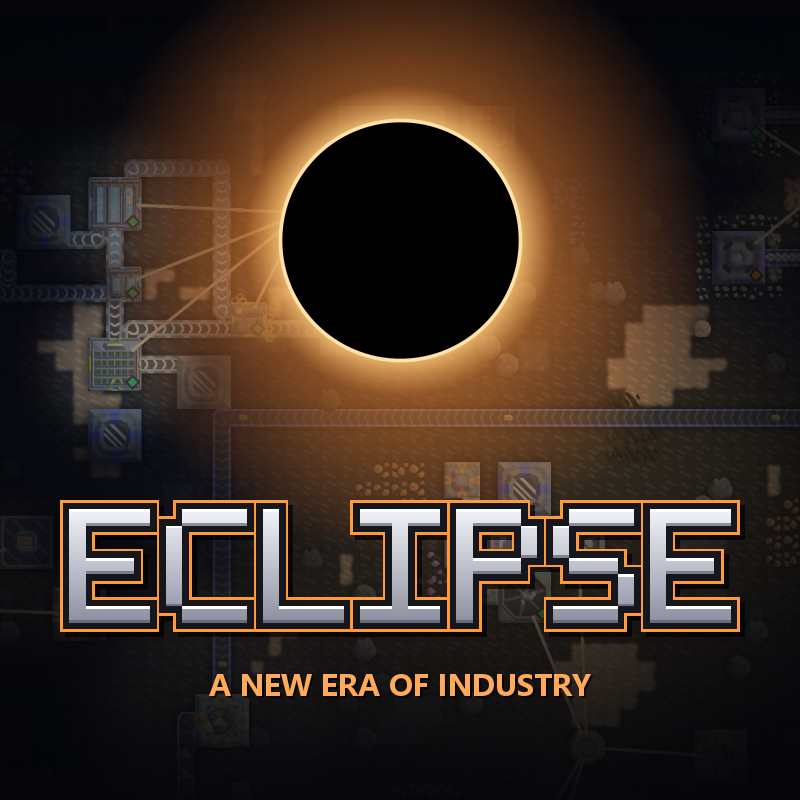

  <b>A Mindustry mod that turns Serpulo into a deep industrial game.</b> 
  Real machine parts, chemistry that bites back, new metals, upgrade modules you manufacture yourself,
  robots, smarter logistics, 14 new turrets and two enemy factions that join your waves.

  <b>154 buildings · 14 turrets · 46 new materials · 24 liquids and gases · 70 upgrade modules · 20 units · 7 ores</b>

  <a href="https://github.com/palle00/ECLIPSE-build/releases/latest"><b>⬇ Download the latest release</b></a>

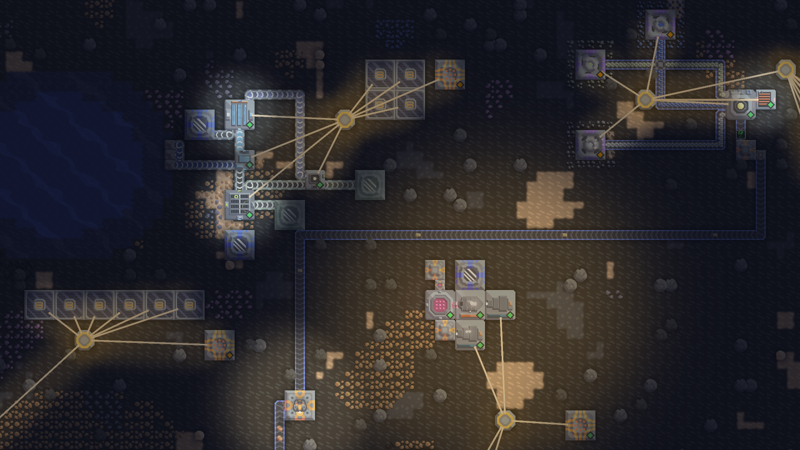

## Install

Requires **Mindustry v8 (build 160 or newer)**. Works on PC (Steam and non-Steam) and Android.

- **In-game:** Mods → Browse → search for **ECLIPSE**.
- **Manual:** download `Eclipse.jar` from [Releases](https://github.com/palle00/ECLIPSE-build/releases/latest), then Mods → Import Mod → Import File.
- **Steam:** subscribe to ECLIPSE on the Steam Workshop.

Everything works in **free play and custom games on any Serpulo map**. No new planet needed: new ores appear on generated sectors and on the premade custom-game maps.

## Made to look like Mindustry

Every ECLIPSE sprite is drawn in vanilla's own pixel style, and every machine is shaped by what it does: you can tell a press from an extruder, a distillation column from a reactor, a cargo drone from a repair drone at a glance. Machines move while they work: presses stamp, rotors turn, crucibles glow, heat shows on the side that receives it.

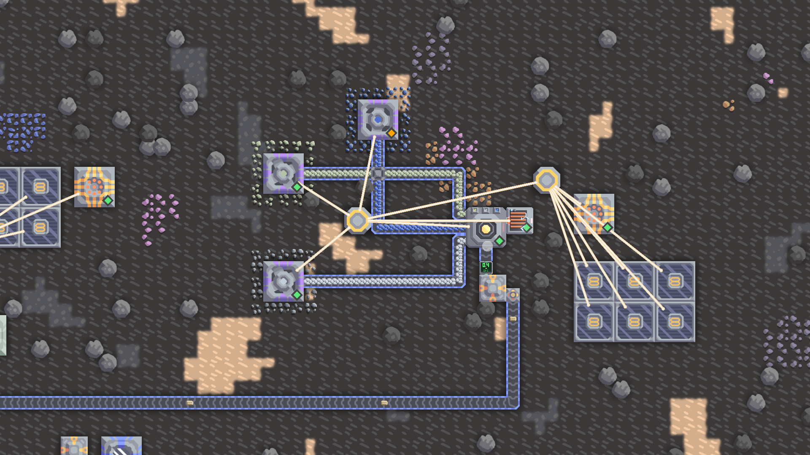

## Industry with depth

- **Mechanical components.** Advanced buildings need gears, titanium rods, bearings, pressure casings, superalloy frames, precision parts and experimental cores, each tier made on its own production line. A Component Depot keeps your core stocked so you can always build.
- **Chemistry.** Water treatment, electrolysis, chlor-alkali, oil distillation, acids, polymers, fertilizer, explosives, carbon fibre and superconductors. Machines with several outputs send each liquid out of a fixed side.
- **Corrosion.** Acids and chlorine eat through ordinary conduits. Pipe them in polymer or metal conduits, and deal with your waste, or it stalls production.
- **Heat.** Furnaces and reactors need heat from heaters, geothermal taps or a fission reactor. Route it with heat exchangers and buffer it in thermal storage.
- **New metals.** Nickel, chromium, cobalt, tungsten, molybdenum and platinum. Mine them, or wash them out of scrap on any map. Smelt superalloy, tungsten carbide and surge superalloy.
- **Power.** Fuel cells, methane turbines, biofuel engines, steam turbines on a fission reactor, four kinds of batteries, and the World Engine, a five-stage megaproject.
- **Lattice Drill.** An endgame drill that outlines its whole ore patch and mines all of it through one building. Pipe in coolant to speed it up, up to 2.65x with liquid nitrogen.

| Chemistry | Fission power |
|---|---|
| 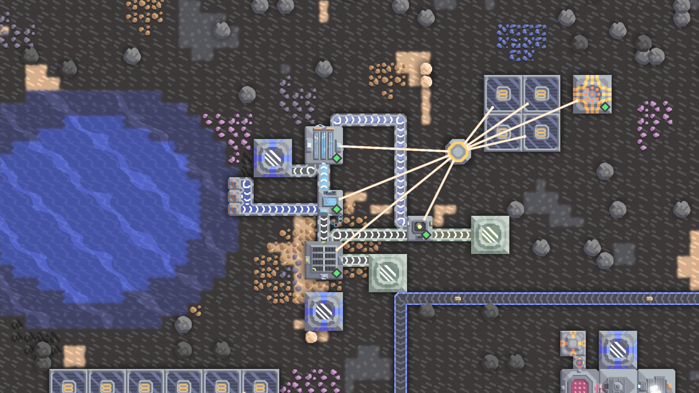 | 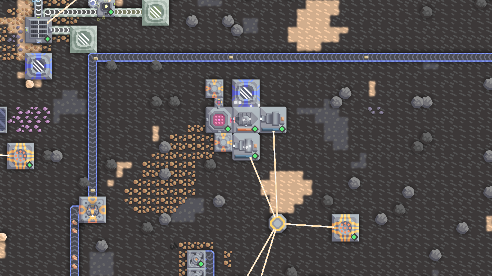 |
| **Components** | **Lattice Drill** |
| 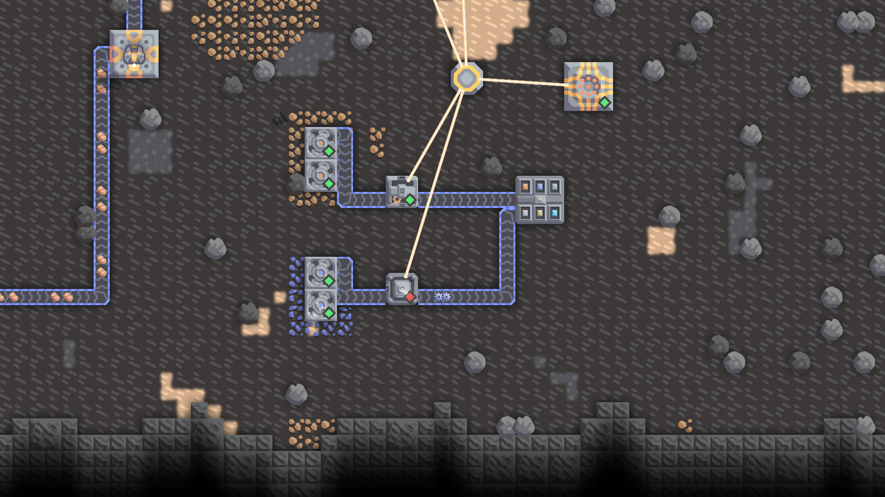 | 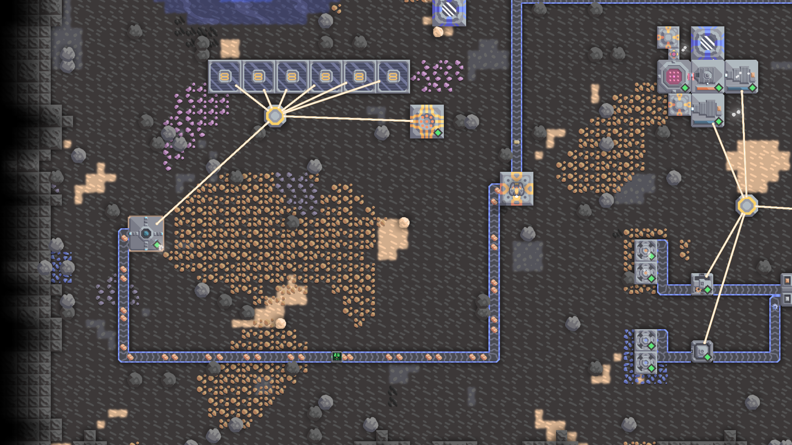 |

## Upgrade modules

Upgrade any machine, vanilla or ECLIPSE, without replacing it. Manufacture modules as real items, belt them to a coupler next to the machine and insert them: faster production, lower power use, more output, recycled inputs, faster drills, turret damage, accuracy and rapid fire. Five tiers, up to legendary modules powered by rare aetherite crystals. Diminishing returns and exclusive pairs keep it a puzzle, not a stack.

## Logistics and robots

- Sorters with rules, priority mergers, ratio splitters, line balancers, buffers with reserves, batch gates and smart unloaders. Routers that never lose or duplicate an item.
- Belts up to 60 items/s and conduits up to 6000 liquid/s, and the vanilla junction, bridge and phase conveyor keep up with them.
- **Flow Meter:** a cheap belt block with an LCD showing items per second, readable by logic processors, per material.
- **Robot Dispatch Hub:** logistics, repair and shield drones you assign to jobs.

## 14 new turrets, one for every stage of the game

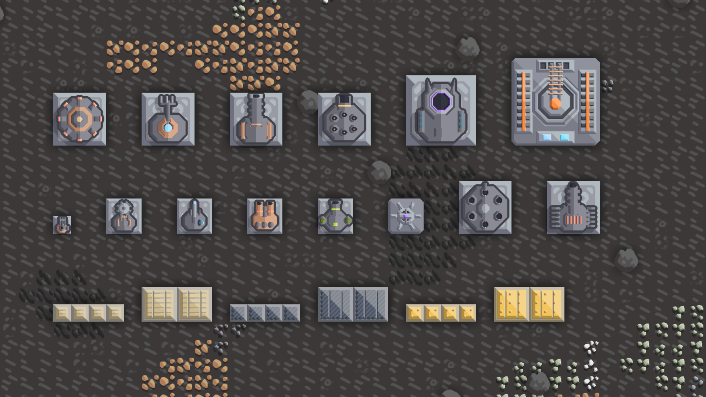

| Turret | What it does |
|---|---|
| **Rivet** | A tiny gatling that fires up to three times faster the longer it keeps shooting. |
| **Sickle** | Throws a sawblade that flies out and comes back, cutting through ground units both ways. |
| **Minelayer** | Lobs mines onto the enemy's path. |
| **Acid Mortar** | Long-range acid shells that etch armour and leave corrosive pools. |
| **Heat Lance** | A beam powered by heat instead of electricity. |
| **Tremor** | Slams the ground: a shockwave that throws enemies back and slows them. |
| **Jammer** | Slows the weapons of every enemy in range. |
| **Piledriver** | A carbide slug that punches through three tanks in a line. |
| **Kestrel** | Guided interceptors that always go for the strongest aircraft. |
| **Thunderhead** | Chain lightning that jumps through a whole flock. |
| **Cloudbreaker** | Fills the sky around it with floating mines. |
| **Apiary** | Launches drones that circle the enemy and shoot ground and air alike. |
| **Event Horizon** | Fires a singularity that drags every enemy together, then collapses in a huge blast. |
| **Orbital Weapons Platform** | Calls down a strike anywhere within 150 blocks. |

## Defense and war

- **New ammunition** for vanilla turrets: armour-piercing carbide, armour-etching sulfur and EMP shells.
- **Two new unit lines** built in the vanilla factories: tanks from Reaper to Colossus, strike aircraft from Wraith to Leviathan, plus a one-per-team Dreadnought titan and an Electronic Warfare Drone that slows enemy turrets.
- **Wave intelligence:** see exactly what the next wave holds, show it on logic displays, delay it, shield your units, repair key buildings.
- **Every turret shows its DPS, kills and damage done**, vanilla ones too.

| Units | Defense |
|---|---|
| 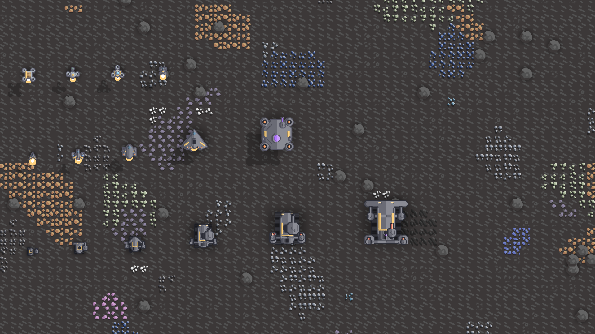 | 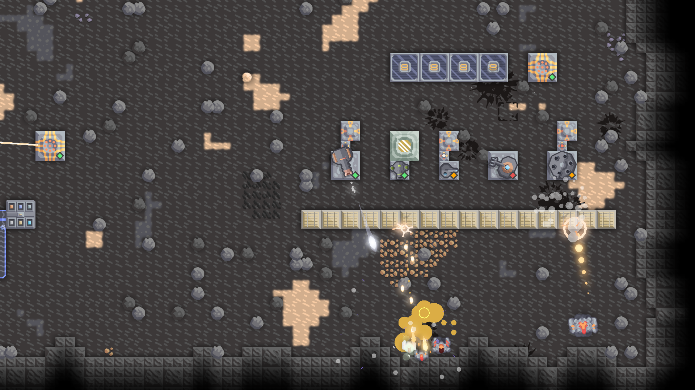 |

## Enemy factions

Custom games with waves get two factions on top of the map's own waves: **the Swarm** on every 2nd wave (self-repairing biological machines that split and breed) and **the Dominion** on every 3rd (few, heavily armoured units with shields). Every 6th wave they attack together.

## Made to be learned

- **ECLIPSE Wiki** in the pause menu: a step-by-step Getting Started guide, guides for every system and an entry for every block, material and unit. Press **I** over any ECLIPSE block to open its page.
- **Animated setup pictures:** every machine's wiki page shows a small working setup built from its real recipe.
- Machines tell you **why they stopped** ("Brine has nowhere to go", "No heat").
- Placement hints show liquid output sides and how much heat a heater delivers.
- **Upgrade Section:** hold Alt with a better belt, conduit or wall selected to upgrade a whole connected line at once.
- A new **ECLIPSE main menu**: a dusk landscape under the eclipse.
- A **Showcase** custom map with every ECLIPSE block running side by side, and a numbered tour.

| In-game wiki | Main menu |
|---|---|
| 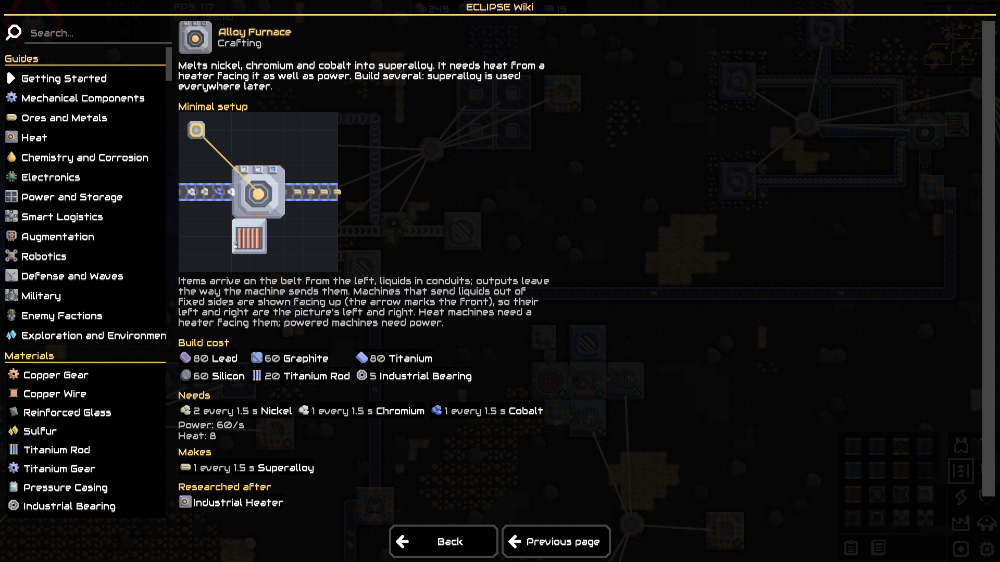 |  |

## Everything in the mod

Show all 321 items, liquids, blocks and units

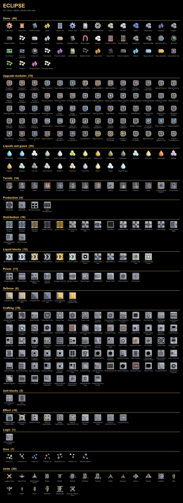

## Good to know

- Requires Mindustry v8 (build 160 or newer). Java mod.
- Serpulo only. Erekir is not supported.
- Balance is still being tuned. Feedback and bug reports are very welcome in [Issues](https://github.com/palle00/ECLIPSE-build/issues).

## License

ECLIPSE, Copyright (C) 2026 palle00

This program is free software: you can redistribute it and/or modify it under the terms of the GNU General Public License as published by the Free Software Foundation, version 3. It is distributed in the hope that it will be useful, but WITHOUT ANY WARRANTY; without even the implied warranty of MERCHANTABILITY or FITNESS FOR A PARTICULAR PURPOSE. See [LICENSE](LICENSE) for the full text.
