

  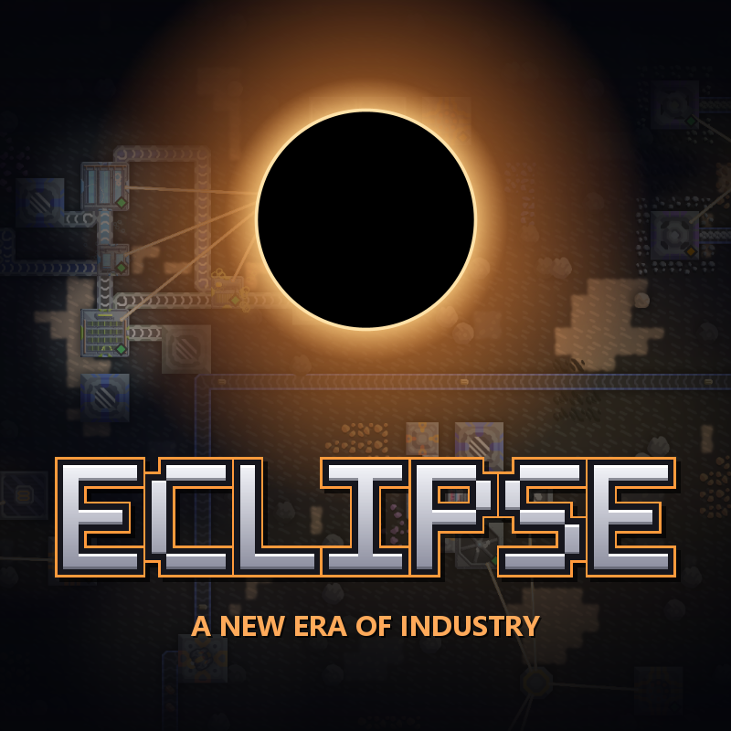

  <b>A Mindustry mod that turns Serpulo and Erekir into a deep industrial game.</b> 
  Universal machines on power tiers, machine parts built from bolts and motors, real chemistry, new metals,
  upgrade modules you manufacture yourself,
  robots, smarter logistics, 19 new turrets, three enemy factions that join your waves and three new planets to fight them on.

  <b>139 buildings · 19 turrets · 92 new materials · 29 liquids and gases · 70 upgrade modules · 30 units · 8 ores</b>

  <a href="https://github.com/palle00/ECLIPSE-build/releases/latest"><b>⬇ Download the latest release</b></a>

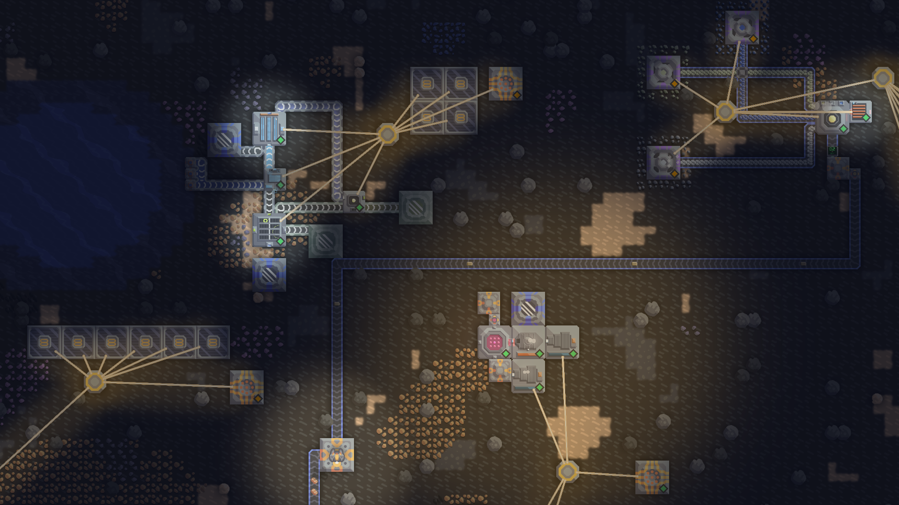

## Install

Requires **Mindustry v8 (build 160 or newer)**. Works on PC (Steam and non-Steam) and Android.

- **In-game:** Mods → Browse → search for **ECLIPSE**.
- **Manual:** download `Eclipse.jar` from [Releases](https://github.com/palle00/ECLIPSE-build/releases/latest), then Mods → Import Mod → Import File.
- **Steam:** subscribe to ECLIPSE on the Steam Workshop.

Everything works in **the Serpulo campaign, free play and custom games on any Serpulo map**: new ores appear on generated sectors and on the premade custom-game maps. Three new ECLIPSE planets share Serpulo's research (see [Enemy factions](#enemy-factions)).

## Made to look like Mindustry

Every ECLIPSE sprite is drawn in vanilla's own pixel style, and every machine is shaped by what it does: you can tell a press from an extruder, a distillation column from a reactor, a cargo drone from a repair drone at a glance. Machines move while they work: presses stamp, rotors turn, crucibles glow, heat shows on the side that receives it.

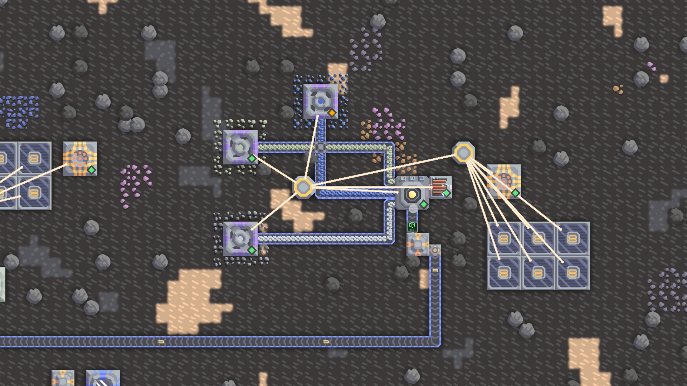

## Industry with depth

- **Universal machines.** One Gear Press makes every gear, one Assembler every part, one Electrolyzer every electrolysis. Tap a machine to pick a recipe; hover a choice to see what it needs.
- **Power tiers and overclocking.** Every recipe needs its tier's power in full (30 to 7680 power/s) or the machine stops. Overclock a machine for double, quadruple or eight times the speed, at a steep power price.
- **Crafting depth.** Metal is pressed into plates, extruded into rods and wire, turned into bolts, rings and springs, and assembled with resistors and transistors into motors, pumps, pistons and sensors, before it becomes the pressure casings, bearings and frames buildings are made of. A Component Depot keeps your core stocked so you can always build.
- **Real chemistry.** Haber-Bosch, Ostwald, chlor-alkali, Bayer, Hall-Héroult, Kroll and more, with real ratios and byproducts: neutralized acid becomes brine for the electrolyzer, captured CO₂ becomes soda ash for glass. Machines with several outputs send each liquid out of a fixed side.
- **Hot metals.** Metal and glass from the furnaces come out glowing and must be cooled in a Vacuum Freezer before use.
- **Corrosion.** Acids and chlorine eat through ordinary conduits. Pipe them in polymer or metal conduits, and deal with your waste, or it stalls production.
- **Heat.** Furnaces and reactors need heat from heaters, geothermal taps or a fission reactor. Route it with heat exchangers and buffer it in thermal storage.
- **New metals.** The veins hold real ore minerals (pentlandite, chromite, cobaltite, wolframite, molybdenite, sperrylite, bauxite). Crush them for 1 metal per ore, float them for 1.5 with byproducts, or leach them for 2, with cobalt and platinum out of nickel ore. Or wash metals out of scrap on any map. Smelt superalloy, tungsten carbide and surge superalloy.
- **Power.** Fuel cells, methane turbines, biofuel engines, solar farms, combined-cycle turbines, steam turbines on a fission or breeder reactor, a fusion reactor fuelled by deuterium and lithium, four kinds of batteries, and the World Engine, a six-stage megaproject.
- **Lattice Drill.** An endgame drill that outlines its whole ore patch and mines all of it through one building. Pipe in coolant to speed it up, up to 2.65x with liquid nitrogen.

| Chemistry | Fission power |
|---|---|
| 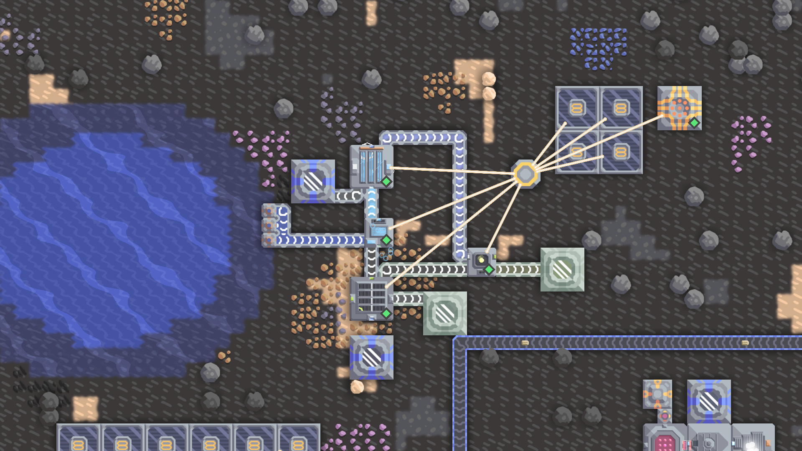 | 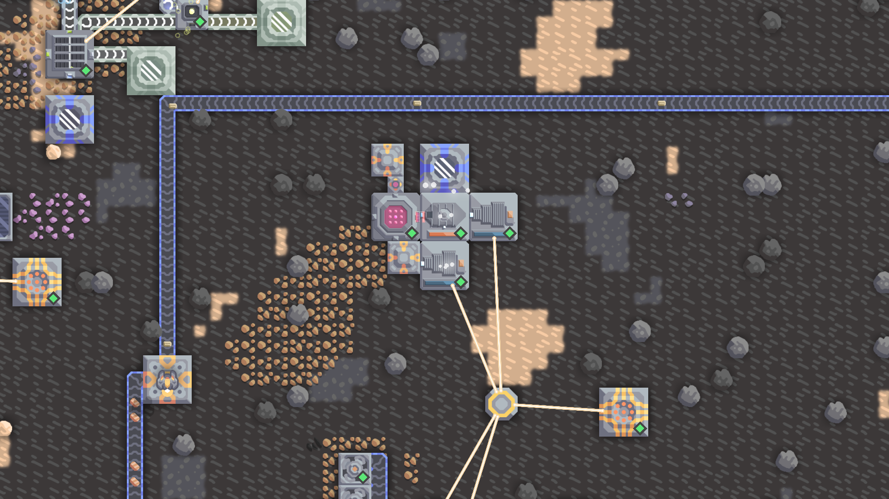 |
| **Components** | **Lattice Drill** |
| 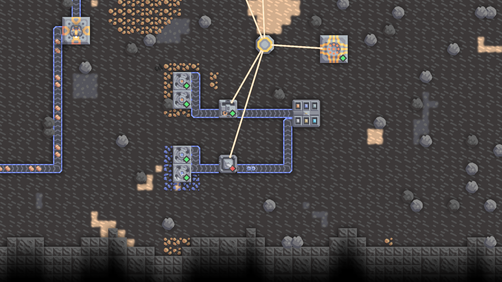 | 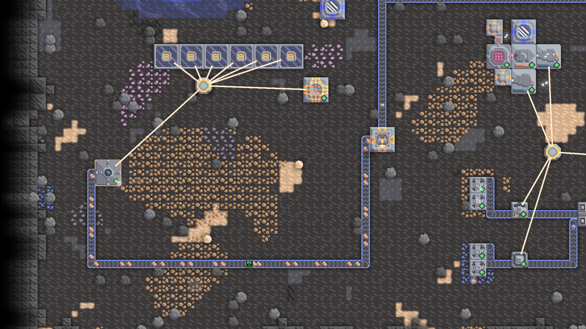 |

## Upgrade modules

Upgrade any machine, vanilla or ECLIPSE, without replacing it. Manufacture modules as real items, belt them to a coupler next to the machine and insert them: faster production, lower power use, more output, recycled inputs, faster drills, turret damage, accuracy and rapid fire. Five tiers, up to legendary modules powered by rare aetherite crystals. Diminishing returns and exclusive pairs keep it a puzzle, not a stack.

## Logistics and robots

- Sorters with rules, priority mergers, ratio splitters, line balancers, buffers with reserves, batch gates and smart unloaders. Routers that never lose or duplicate an item.
- Belts up to 60 items/s and conduits up to 6000 liquid/s, and the vanilla junction, bridge and phase conveyor keep up with them.
- **Flow Meter:** a cheap belt block with an LCD showing items per second, readable by logic processors, per material.
- **Robot Dispatch Hub:** logistics, repair and shield drones you assign to jobs.

## 19 new turrets, one for every stage of the game

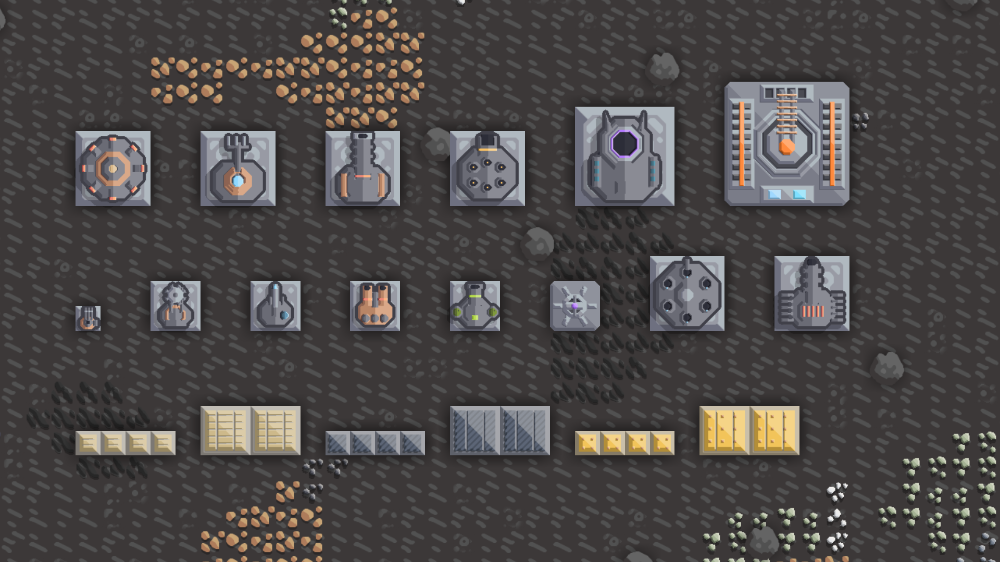

| Turret | What it does |
|---|---|
| **Rivet** | A tiny gatling that fires up to three times faster the longer it keeps shooting. |
| **Sickle** | Throws a sawblade that flies out and comes back, cutting through ground units both ways. |
| **Minelayer** | Lobs mines onto the enemy's path. |
| **Acid Mortar** | Long-range acid shells that etch armour and leave corrosive pools. |
| **Heat Lance** | A beam powered by heat instead of electricity. |
| **Tremor** | Slams the ground: a shockwave that throws enemies back and slows them. |
| **Jammer** | Slows the weapons of every enemy in range. |
| **Piledriver** | A carbide slug that punches through three tanks in a line. |
| **Bombard** | Siege mortar with the longest range of any turret, but a blind spot around itself. |
| **Primer** + **Stardust Launcher** | The Supernova: the Launcher scatters clouds of almost any item, the Primer pulls them into one blast that grows with every cloud. |
| **Sonar** | Finds the Tide's submerged submarines so your turrets can hit them. |
| **Payload Catapult** | Throws whole blocks: a container of blast compound, a tank of oil, a charged battery. They blow up where they land. |
| **Kestrel** | Guided interceptors that always go for the strongest aircraft. |
| **Thunderhead** | Chain lightning that jumps through a whole flock. |
| **Cloudbreaker** | Fills the sky around it with floating mines. |
| **Apiary** | Launches drones that circle the enemy and shoot ground and air alike. |
| **Event Horizon** | Fires a singularity that drags every enemy together, then collapses in a huge blast. |
| **Orbital Weapons Platform** | Calls down a strike anywhere within 150 blocks. |

## Defense and war

- **New ammunition** for vanilla turrets: armour-piercing carbide, armour-etching sulfur and EMP shells.
- **Two new unit lines** built in the vanilla factories: tanks from Reaper to Colossus, strike aircraft from Wraith to Leviathan, plus a one-per-team Dreadnought titan and an Electronic Warfare Drone that slows enemy turrets.
- **Two new cores** after the Nucleus: Core: Bastion and Core: Citadel, with more storage, a higher unit cap, a built-in power node and their own builders, Delta and Epsilon.
- **Wave intelligence:** see exactly what the next wave holds, show it on logic displays, delay it, shield your units, repair key buildings.
- **Every turret shows its DPS, kills and damage done**, vanilla ones too.

| Units | Defense |
|---|---|
| 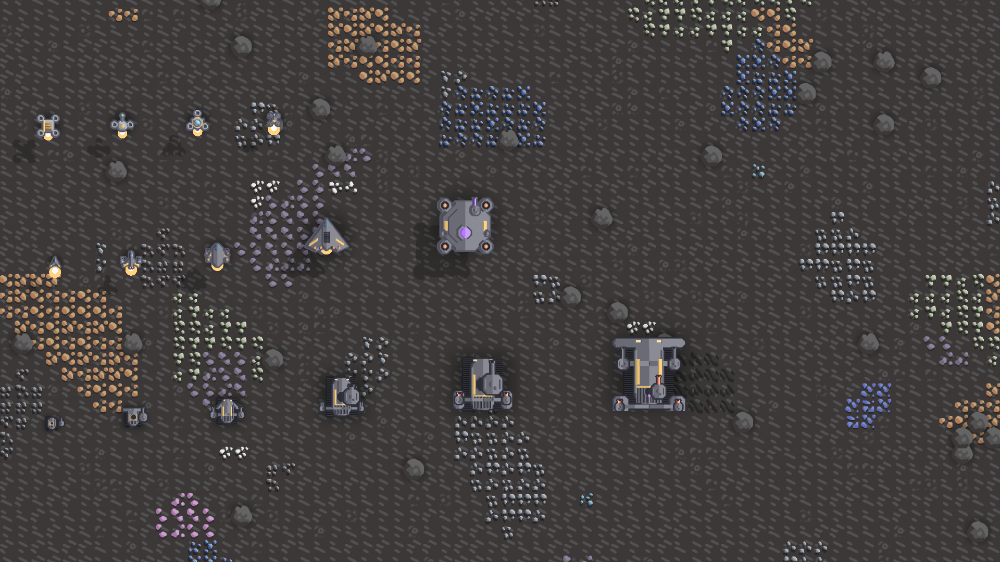 | 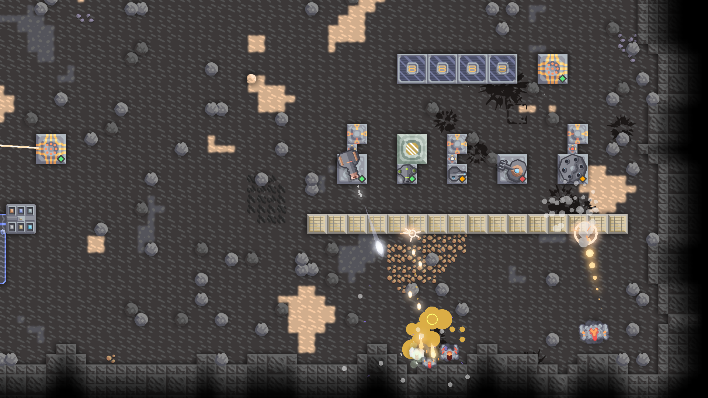 |

## Enemy factions

Custom games and campaign sectors with waves get three factions on top of the map's own waves:

- **The Swarm** on every 2nd wave: self-repairing biological machines that split and breed.
- **The Dominion** on every 3rd: few, heavily armoured units with shields.
- **The Tide** on every 5th: amphibious boats that cross water and land, each spraying a liquid that sets up a reaction for the others. On maps with a spawn point at sea it also sends submarines that can't be hit under water until a Sonar finds them.

**The ECLIPSE:** every 5th wave may bring an eclipse, more likely the longer the game goes on. The sky darkens, and until the next wave every enemy is tougher and hits harder.

**Three new planets**, one per faction, share Serpulo's research and are reached by launching from Serpulo: **Tide**, an ocean world of islands; **Hive**, a spore jungle; **Ironhold**, an industrial wasteland. Each has its own ground, cliffs and plants, and is attacked only by its own faction.

**On Erekir** the factions join Erekir's waves too, three times as tough to match Erekir's stronger defences.

## Made to be learned

- **ECLIPSE Wiki** in the pause menu, or press **I** over any ECLIPSE block or unit. Every page has a header with the key facts and tabs instead of one long scroll; recipes are cards with the rate of every input and output. Search knows recipes: type a material to see its ore, what makes it and what uses it. Pin the pages you use, go back and forward like a browser.
- **Build examples:** every machine shows animated, ratio-correct builds with the real items riding the belts, liquids in their pipes, heaters on the right sides and a rate on every belt. Hover anything to see what it carries, step through the build, and press **Build this** to put it on your cursor as a schematic. Furnaces whose metal comes out hot also show the full line, as many furnaces as one Vacuum Freezer keeps up with.
- **Chain tab** on every item: the whole production chain drawn as a flow down to raw materials, with how many machines it takes and the power the grid needs.
- **Getting Started** in chapters, with checklists that tick themselves from your base. Over a stopped machine, **I** opens its page with why it stopped and how to fix it.
- **Comparison tables** in the wiki: generators, turrets and units side by side, read from the game data.
- Machines tell you **why they stopped** ("Brine has nowhere to go", "No heat", "Underpowered: needs 480/s"). Press **K** to mark every stopped machine on the map.
- **Production panel** (**O**, or from the wiki): what needs attention (stopped machines and why, shortages, power), how much of every item and liquid your base makes and uses and which machines do it, and what a chain still needs built.
- A **search box** above the build menu finds any block by name.
- Placement hints show liquid output sides, how much heat a heater delivers, and how many machines it takes to feed the one you are placing.
- **Logic:** processors can read ECLIPSE machines (status, recipe, overclock, heat, pressure, the next wave...) with `esensor`, set overclock, recipe or the Orbital Platform's target with `econtrol`, and look up recipes with `recipe`. Every block's wiki page lists what it answers, and a Logic guide has ready-to-paste programs.
- **Upgrade Section:** hold Alt with a better belt, conduit or wall selected to upgrade a whole connected line at once.
- A new **ECLIPSE main menu**: Continue your last game in one click, a Play panel with your planets and recent saves, the wiki, news and tips; the eclipse forms while the game loads.
- A **Showcase** custom map with every ECLIPSE block running side by side, and a numbered tour.

| In-game wiki | Main menu |
|---|---|
| 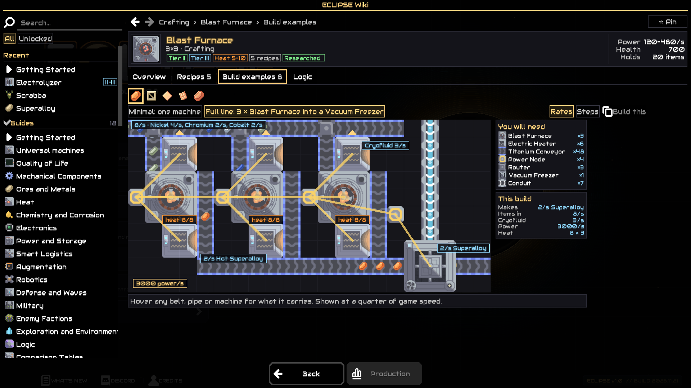 | 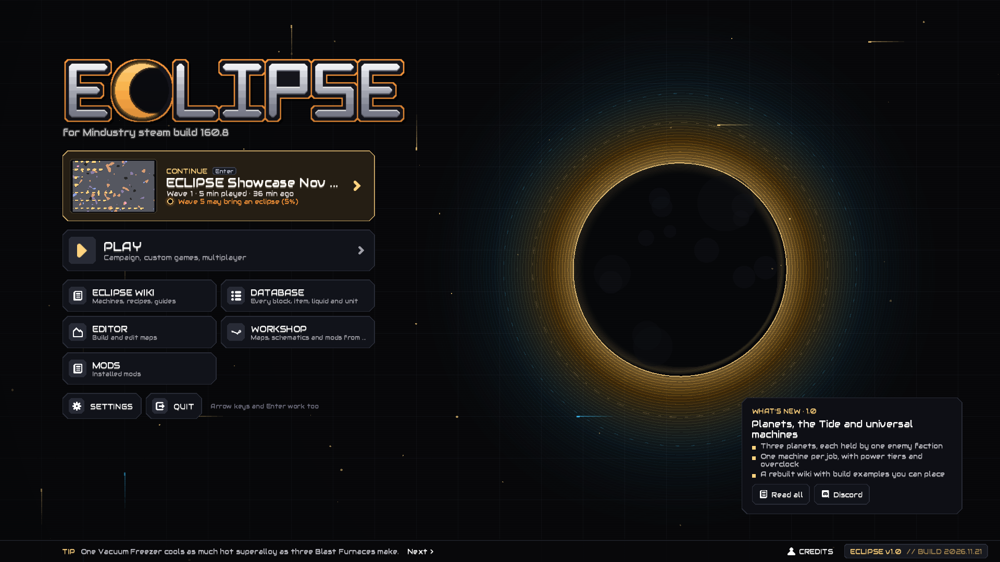 |

## Everything in the mod

Show all 370 items, liquids, blocks and units

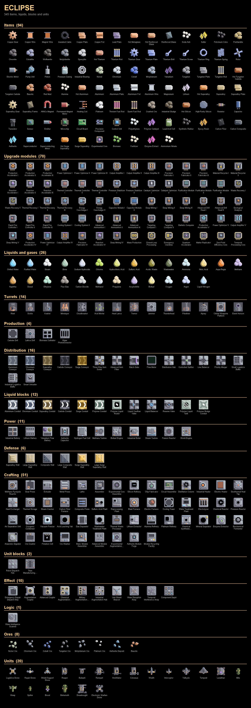

## Good to know

- Requires Mindustry v8 (build 160 or newer). Java mod.
- Serpulo, Erekir and the three ECLIPSE planets. On Erekir, ECLIPSE and the Serpulo basics it needs can be researched and built, and Erekir maps get copper, lead, titanium, coal, scrap and the ECLIPSE ores on their first load.
- ECLIPSE uses vanilla tungsten and carbide (it had its own before 1.0); saves from older versions keep their tungsten and carbide.
- Every ECLIPSE option is in **Settings → ECLIPSE**, also reachable from the new pause menu.
- Multiplayer works, but acid corrosion has not been tested with real players yet.
- Balance is still being tuned. Feedback and bug reports are very welcome in [Issues](https://github.com/palle00/ECLIPSE-build/issues).

## License

ECLIPSE, Copyright (C) 2026 palle00

This program is free software: you can redistribute it and/or modify it under the terms of the GNU General Public License as published by the Free Software Foundation, version 3. It is distributed in the hope that it will be useful, but WITHOUT ANY WARRANTY; without even the implied warranty of MERCHANTABILITY or FITNESS FOR A PARTICULAR PURPOSE. See [LICENSE](LICENSE) for the full text.

**Additional term (GPL-3.0 section 7(b)):** If you distribute this work, or any work based on it, you must credit palle00 as the original author of ECLIPSE, with a link to https://github.com/palle00/ECLIPSE-build. The credit must be placed where users can reasonably see it, such as the mod description, the mod's download page, or its README.
